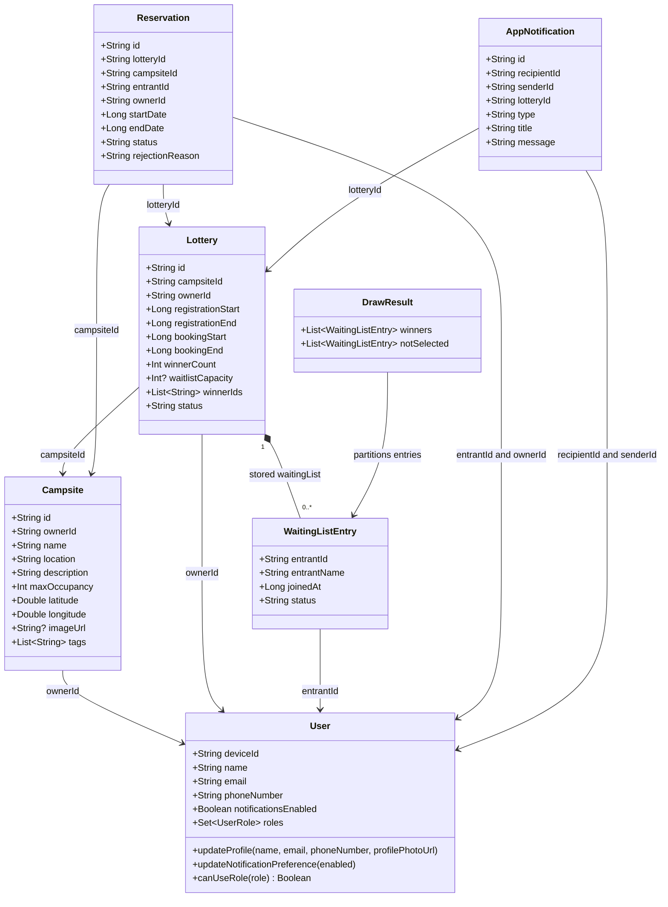
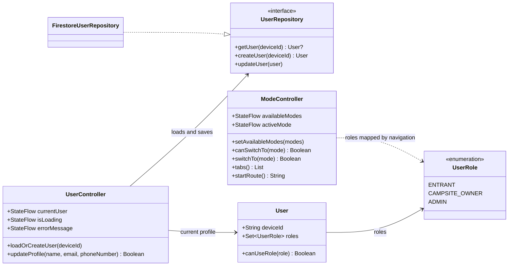
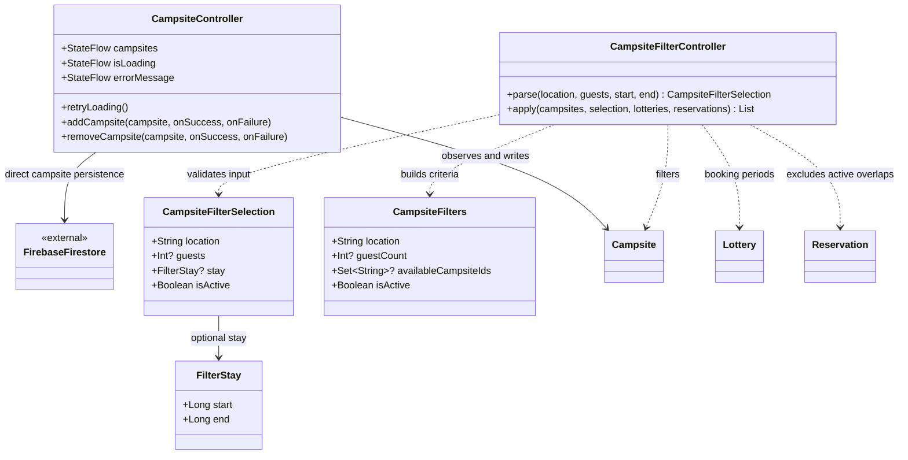
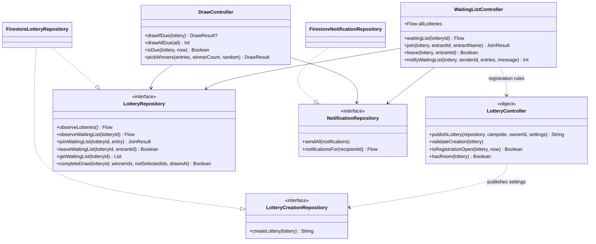
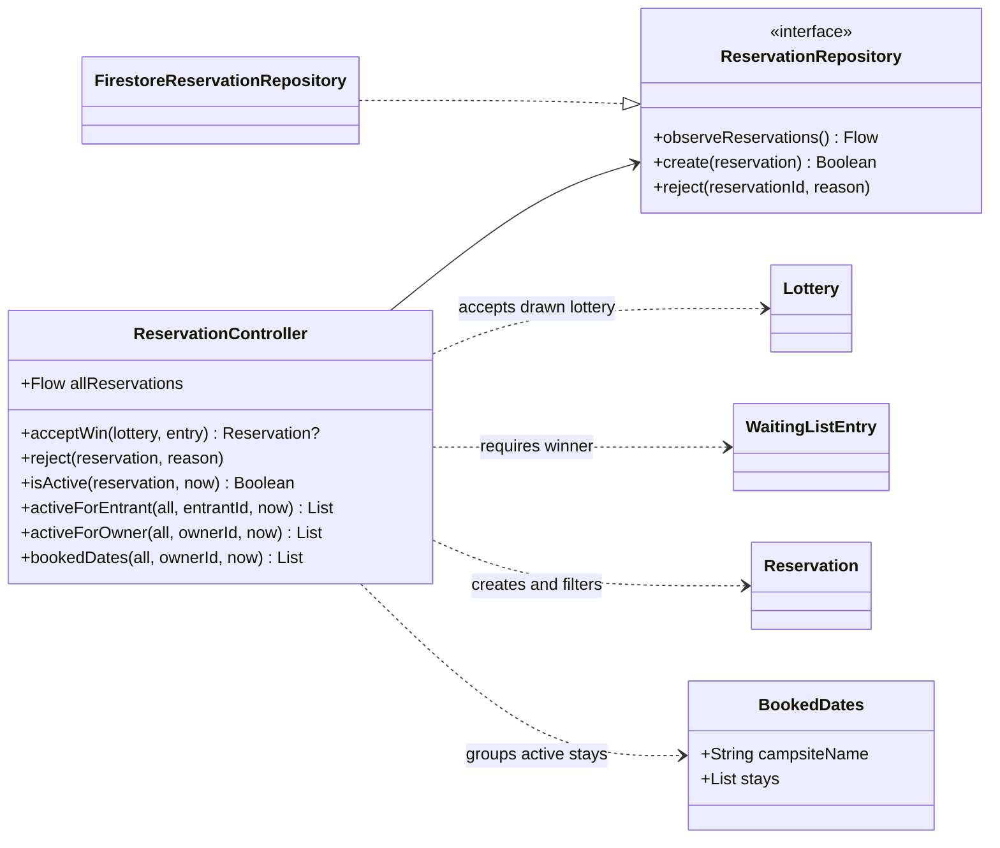
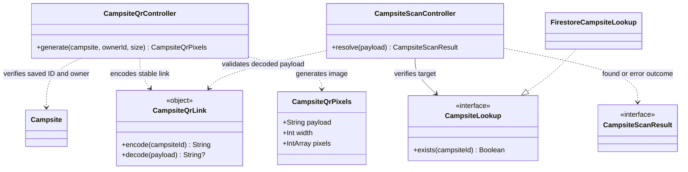
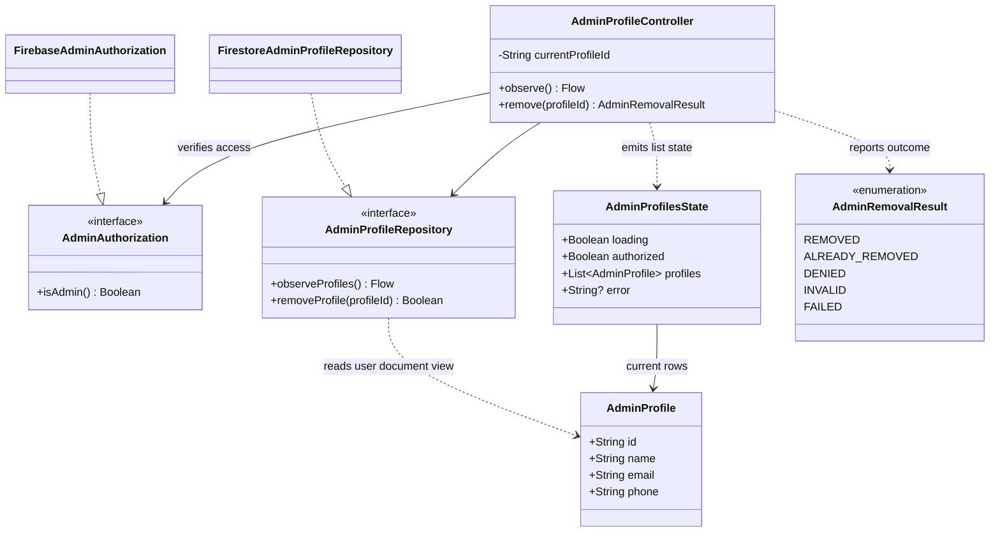

# UML Class Diagrams

Updated November 6, 2026 with the diagram supplied by Dean.

## Current UML diagram

[Open the full-size original SVG](https://raw.githubusercontent.com/wiki/CMPUT301F26-symbol/symbol-cyber/images/uml/updated.drawio.svg). The file is preserved unchanged, including its embedded draw.io data. Download it and open it in diagrams.net to edit the diagram.

## Earlier implementation views

The earlier code-linked diagrams are retained below as a separate implementation snapshot.

Show the earlier implementation diagrams and notes

This page documents the implemented object-oriented design of Symbol. Weekly planning remains in [Sprint Planning and Reviews](https://github.com/CMPUT301F26-symbol/symbol-cyber/wiki/Sprint-Planning-and-Reviews), and milestone feedback remains in [Project Part 2 Feedback](https://github.com/CMPUT301F26-symbol/symbol-cyber/wiki/Project-Part-2-Feedback).

**Design snapshot:** main [`1c98fd0`](https://github.com/CMPUT301F26-symbol/symbol-cyber/commit/1c98fd020d386731743e2c413e004393b45240fa), checked November 6, 2026. These diagrams describe existing code rather than claiming every backlog story is complete. Selected attributes and public methods are shown; signatures abbreviate parameter types, coroutine modifiers and defaults. Important nullable results are explained below each diagram.

**Notation:** `+` public; `-` private; solid arrow association/reference; dashed arrow dependency; dashed arrow with a hollow triangle interface implementation; filled diamond storage containment. Interfaces and Kotlin singleton objects are labeled explicitly. Classes with the same name across diagrams refer to the same implemented type.

## Diagram index

| Diagram | Scope |
| --- | --- |
| [Domain model](#domain-model) | Users, campsites, lotteries, waitlist entries, reservations, notifications and draw results |
| [Device identity, profile and modes](#device-identity-profile-and-modes) | Profile loading, persistence, roles and navigation state |
| [Campsite management and filtering](#campsite-management-and-filtering) | Registration/removal, search/filter inputs and availability dependencies |
| [Lottery creation, waiting list, draw and notifications](#lottery-creation-waiting-list-draw-and-notifications) | Lottery rules and repository boundaries |
| [Reservations and booked dates](#reservations-and-booked-dates) | Winner acceptance, active reservations and rejection |
| [QR generation and scanning](#qr-generation-and-scanning) | Stable campsite links, code images and verified lookup |
| [Administrator profile management](#administrator-profile-management) | Authorized browsing/removal and result state |

## Domain model

Associations labeled with IDs are logical Firestore references, not embedded Kotlin objects or enforced foreign keys. The filled diamond describes the lottery waiting-list subcollection. Removing a profile does not cascade to campsite or reservation documents. Nullable values, defaults, generated data-class methods and some display fields are omitted for readability.

Source: [User.kt](https://github.com/CMPUT301F26-symbol/symbol-cyber/blob/1c98fd020d386731743e2c413e004393b45240fa/code/app/src/main/java/com/example/code/User.kt), [Campsite.kt](https://github.com/CMPUT301F26-symbol/symbol-cyber/blob/1c98fd020d386731743e2c413e004393b45240fa/code/app/src/main/java/com/example/code/model/Campsite.kt), [Lottery.kt](https://github.com/CMPUT301F26-symbol/symbol-cyber/blob/1c98fd020d386731743e2c413e004393b45240fa/code/app/src/main/java/com/example/code/model/Lottery.kt), [WaitingListEntry.kt](https://github.com/CMPUT301F26-symbol/symbol-cyber/blob/1c98fd020d386731743e2c413e004393b45240fa/code/app/src/main/java/com/example/code/model/WaitingListEntry.kt), [Reservation.kt](https://github.com/CMPUT301F26-symbol/symbol-cyber/blob/1c98fd020d386731743e2c413e004393b45240fa/code/app/src/main/java/com/example/code/model/Reservation.kt), [AppNotification.kt](https://github.com/CMPUT301F26-symbol/symbol-cyber/blob/1c98fd020d386731743e2c413e004393b45240fa/code/app/src/main/java/com/example/code/model/AppNotification.kt), [DrawResult.kt](https://github.com/CMPUT301F26-symbol/symbol-cyber/blob/1c98fd020d386731743e2c413e004393b45240fa/code/app/src/main/java/com/example/code/model/DrawResult.kt).

## Device identity, profile and modes

One User can hold several UserRole values; separate Entrant, CampsiteOwner and Admin subclasses are not part of this implementation. AppNavHost maps roles to available modes and calls ModeController; the dependency shown is that navigation mapping, not a direct UserRole import in ModeController. UserRepository.getUser may return null for a new device.

Source: [User.kt](https://github.com/CMPUT301F26-symbol/symbol-cyber/blob/1c98fd020d386731743e2c413e004393b45240fa/code/app/src/main/java/com/example/code/User.kt), [UserController.kt](https://github.com/CMPUT301F26-symbol/symbol-cyber/blob/1c98fd020d386731743e2c413e004393b45240fa/code/app/src/main/java/com/example/code/controller/UserController.kt), [UserRepository.kt](https://github.com/CMPUT301F26-symbol/symbol-cyber/blob/1c98fd020d386731743e2c413e004393b45240fa/code/app/src/main/java/com/example/code/data/UserRepository.kt), [ModeController.kt](https://github.com/CMPUT301F26-symbol/symbol-cyber/blob/1c98fd020d386731743e2c413e004393b45240fa/code/app/src/main/java/com/example/code/navigation/ModeController.kt), [AppNavHost.kt](https://github.com/CMPUT301F26-symbol/symbol-cyber/blob/1c98fd020d386731743e2c413e004393b45240fa/code/app/src/main/java/com/example/code/navigation/AppNavHost.kt).

## Campsite management and filtering

CampsiteController currently accesses Firestore directly; no CampsiteRepository abstraction is invented here. Search, ownership and form validation also use top-level helper functions. Filtering uses published lottery booking periods and active reservations; guests and stay are optional. The UI waits for the initial availability snapshots before applying date matches.

Source: [CampsiteController.kt](https://github.com/CMPUT301F26-symbol/symbol-cyber/blob/1c98fd020d386731743e2c413e004393b45240fa/code/app/src/main/java/com/example/code/controller/CampsiteController.kt), [CampsiteFilterController.kt](https://github.com/CMPUT301F26-symbol/symbol-cyber/blob/1c98fd020d386731743e2c413e004393b45240fa/code/app/src/main/java/com/example/code/controller/CampsiteFilterController.kt), [CampsiteFilters.kt](https://github.com/CMPUT301F26-symbol/symbol-cyber/blob/1c98fd020d386731743e2c413e004393b45240fa/code/app/src/main/java/com/example/code/model/CampsiteFilters.kt), [CampsiteForm.kt](https://github.com/CMPUT301F26-symbol/symbol-cyber/blob/1c98fd020d386731743e2c413e004393b45240fa/code/app/src/main/java/com/example/code/model/CampsiteForm.kt), [CampsiteSearch.kt](https://github.com/CMPUT301F26-symbol/symbol-cyber/blob/1c98fd020d386731743e2c413e004393b45240fa/code/app/src/main/java/com/example/code/model/CampsiteSearch.kt), [CampsiteOwnership.kt](https://github.com/CMPUT301F26-symbol/symbol-cyber/blob/1c98fd020d386731743e2c413e004393b45240fa/code/app/src/main/java/com/example/code/model/CampsiteOwnership.kt).

## Lottery creation, waiting list, draw and notifications

FirestoreLotteryRepository implements both repository interfaces. Draw scheduling is the AutomaticDraw composable loop while a device has the app open, not a separate server scheduler. DrawController.drawIfDue may return null when no draw is performed. Notifications use the existing in-app notification collection.

Source: [LotteryController.kt](https://github.com/CMPUT301F26-symbol/symbol-cyber/blob/1c98fd020d386731743e2c413e004393b45240fa/code/app/src/main/java/com/example/code/controller/LotteryController.kt), [WaitingListController.kt](https://github.com/CMPUT301F26-symbol/symbol-cyber/blob/1c98fd020d386731743e2c413e004393b45240fa/code/app/src/main/java/com/example/code/controller/WaitingListController.kt), [DrawController.kt](https://github.com/CMPUT301F26-symbol/symbol-cyber/blob/1c98fd020d386731743e2c413e004393b45240fa/code/app/src/main/java/com/example/code/controller/DrawController.kt), [LotteryRepository.kt](https://github.com/CMPUT301F26-symbol/symbol-cyber/blob/1c98fd020d386731743e2c413e004393b45240fa/code/app/src/main/java/com/example/code/data/LotteryRepository.kt), [LotteryCreationRepository.kt](https://github.com/CMPUT301F26-symbol/symbol-cyber/blob/1c98fd020d386731743e2c413e004393b45240fa/code/app/src/main/java/com/example/code/data/LotteryCreationRepository.kt), [NotificationRepository.kt](https://github.com/CMPUT301F26-symbol/symbol-cyber/blob/1c98fd020d386731743e2c413e004393b45240fa/code/app/src/main/java/com/example/code/data/NotificationRepository.kt), [AutomaticDraw.kt](https://github.com/CMPUT301F26-symbol/symbol-cyber/blob/1c98fd020d386731743e2c413e004393b45240fa/code/app/src/main/java/com/example/code/navigation/AutomaticDraw.kt).

## Reservations and booked dates

A reservation currently uses the lottery booking period. acceptWin may return null if it was already accepted. BookedDates groups active reservations by campsite name in the current implementation. The listed rule helpers are companion-object methods; suspend and default-argument details are omitted from the diagram signatures.

Source: [ReservationController.kt](https://github.com/CMPUT301F26-symbol/symbol-cyber/blob/1c98fd020d386731743e2c413e004393b45240fa/code/app/src/main/java/com/example/code/controller/ReservationController.kt), [ReservationRepository.kt](https://github.com/CMPUT301F26-symbol/symbol-cyber/blob/1c98fd020d386731743e2c413e004393b45240fa/code/app/src/main/java/com/example/code/data/ReservationRepository.kt), [Reservation.kt](https://github.com/CMPUT301F26-symbol/symbol-cyber/blob/1c98fd020d386731743e2c413e004393b45240fa/code/app/src/main/java/com/example/code/model/Reservation.kt).

## QR generation and scanning

The shared CampsiteQrLink encodes only the saved campsite ID. decode returns null for invalid links. Scanning reports Found, Invalid, Missing or Unavailable and verifies the document with a server read before navigation. QR generation rechecks ownership. ZXing handles the actual QR image encoding/decoding; camera and clipboard adapters live in the UI functions.

Source: [CampsiteQrController.kt](https://github.com/CMPUT301F26-symbol/symbol-cyber/blob/1c98fd020d386731743e2c413e004393b45240fa/code/app/src/main/java/com/example/code/qr/CampsiteQrController.kt), [CampsiteQrLink.kt](https://github.com/CMPUT301F26-symbol/symbol-cyber/blob/1c98fd020d386731743e2c413e004393b45240fa/code/app/src/main/java/com/example/code/qr/CampsiteQrLink.kt), [CampsiteScanController.kt](https://github.com/CMPUT301F26-symbol/symbol-cyber/blob/1c98fd020d386731743e2c413e004393b45240fa/code/app/src/main/java/com/example/code/qr/CampsiteScanController.kt), [CampsiteLookup.kt](https://github.com/CMPUT301F26-symbol/symbol-cyber/blob/1c98fd020d386731743e2c413e004393b45240fa/code/app/src/main/java/com/example/code/qr/CampsiteLookup.kt), [CampsiteQrScreen.kt](https://github.com/CMPUT301F26-symbol/symbol-cyber/blob/1c98fd020d386731743e2c413e004393b45240fa/code/app/src/main/java/com/example/code/ui/owner/CampsiteQrScreen.kt), [CampsiteScanScreen.kt](https://github.com/CMPUT301F26-symbol/symbol-cyber/blob/1c98fd020d386731743e2c413e004393b45240fa/code/app/src/main/java/com/example/code/ui/entrant/CampsiteScanScreen.kt).

## Administrator profile management

AdminProfile is a read projection of users documents, not a subclass of User. FirebaseAdminAuthorization checks the refreshed admin custom claim; selecting Admin mode alone is insufficient. Profile deletion requires confirmation in the UI and protects the current profile. Server rules remain a separate authorization boundary. Admin campsite browsing/removal uses CampsiteController from the campsite diagram.

Source: [AdminProfileController.kt](https://github.com/CMPUT301F26-symbol/symbol-cyber/blob/1c98fd020d386731743e2c413e004393b45240fa/code/app/src/main/java/com/example/code/admin/AdminProfileController.kt), [AdminProfileRepository.kt](https://github.com/CMPUT301F26-symbol/symbol-cyber/blob/1c98fd020d386731743e2c413e004393b45240fa/code/app/src/main/java/com/example/code/admin/AdminProfileRepository.kt), [AdminProfileRemovalScreen.kt](https://github.com/CMPUT301F26-symbol/symbol-cyber/blob/1c98fd020d386731743e2c413e004393b45240fa/code/app/src/main/java/com/example/code/ui/admin/AdminProfileRemovalScreen.kt), [AdminProfileDetailsScreen.kt](https://github.com/CMPUT301F26-symbol/symbol-cyber/blob/1c98fd020d386731743e2c413e004393b45240fa/code/app/src/main/java/com/example/code/ui/admin/AdminProfileDetailsScreen.kt).

## UI integration and story traceability

Compose screens and routes are functions, so they are documented here as callers rather than presented as Kotlin classes.

| UI flow | Main collaborators | Related implemented story scope |
| --- | --- | --- |
| App startup and profile | UserController, UserRepository, User, ModeController | US 01.09.01; profile editing; role-based mode selection |
| Explore and campsite details | CampsiteController, CampsiteFilterController, Campsite and presentation helpers | US 01.01.01-.05 |
| Owner registration and details; admin campsite list | CampsiteController, Campsite, form/ownership helpers | US 02.01.01, US 02.01.02, US 02.01.04, US 02.03.01, US 03.01.01, US 03.04.01 |
| Create lottery and waiting-list screens | LotteryController, WaitingListController, lottery repositories | US 02.04.01/.03/.04/.05/.07, US 01.01.06, US 01.02.01/.02, US 02.09.01, US 02.10.01 |
| Automatic draw and reservation screens | DrawController, ReservationController, reservation/notification repositories | US 02.05.01, US 01.06.01, US 02.06.01, US 02.07.01, US 02.08.01; in-app winner notification |
| Owner QR and entrant scan | CampsiteQrController, CampsiteQrLink, CampsiteScanController, CampsiteLookup | US 02.02.01, US 01.12.01 |
| Admin profile list and details | AdminProfileController, AdminAuthorization, AdminProfileRepository | US 03.02.01, US 03.05.01 |

The table maps implemented collaborators and does not certify full acceptance of every listed story. See the story notes and backlog for their separate status and limitations.

## Maintaining the diagrams

Update this page when a model, public controller API or repository relationship changes. Editable Mermaid sources are kept with the repository's `doc/uml/` directory and the versioned page is `doc/UML.md`. Preserve the code snapshot when describing an older design. The [CRC Cards](https://github.com/CMPUT301F26-symbol/symbol-cyber/wiki/CRC-Cards) remain the analysis/design history; this page records the implementation snapshot.

AI assistance: Codex (OpenAI) assisted with reading the implemented classes, organizing the diagrams and drafting this page. No new application behavior, deployment or TA acceptance is claimed by the documentation.

