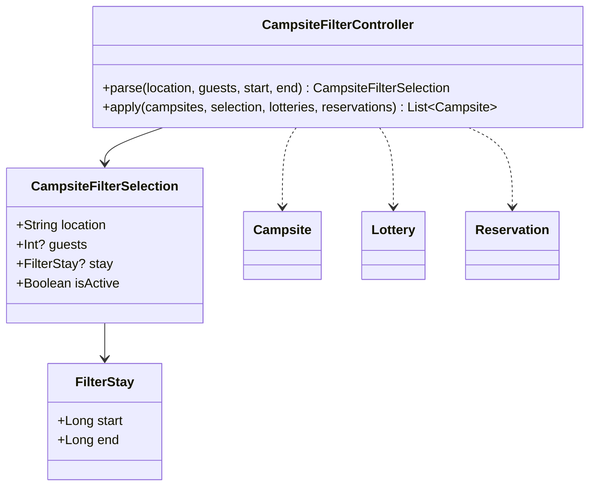

# US 01.01.02 — Filter by location, dates and guests

Refs #2. Branch `US-01.01.02` starts from main `ae688834`; do not merge until Dean authorizes it.

Explore now opens real filter controls. All entered criteria apply together; blank fields are unrestricted. Clear filters resets the filters and keyword search. Invalid guest counts, impossible dates, incomplete date pairs and reversed ranges keep the dialog open with a useful error.

Dates are inclusive and interpreted in the device time zone, matching the owner's existing booking displays. A stay must fit one published lottery booking period and avoid every overlapping ACTIVE reservation for the campsite. REJECTED reservations do not block dates. Missing advertised periods never imply availability. Navigation passes live lottery and reservation snapshots into Explore, and date results wait for both initial snapshots. Existing upstream repositories log read failures rather than propagating them; if they never produce an initial snapshot, availability remains loading.

No Campsite, Lottery, Reservation, registration or draw schema is changed. This preserves Noor's merged lottery creation and Aalok's reservation/draw flows. The code uses the current published-period schema; if Noor renames these fields in a later merge, update the availability adapter/controller rather than duplicating the models.



Verification: `CampsiteFilterControllerTest` covers combined criteria, clearing, capacity overflow, inclusive dates, missing availability, active/rejected bookings, and malformed input. `CampsiteFilterInputTest` exercises the actual controls and live changes with realistic Jasper/Banff fixtures. Run the JVM suite, both debug APK builds, lint and the scoped screen tests before review. Do not close #2 until the integration/demo checks pass.

AI assistance: OpenAI Codex assisted implementation, tests and this feature note. Dean reviews the work. No live Firebase records were modified during development tests.

## AI prompt citation

Suggested replication prompt with the model and date requested by Dean; this is not a verbatim record of the original session.

```kotlin
/** AI USAGE
 * Model: GPT-6.1 Sol
 * Prompt: "Implement combined campsite filters for location, stay dates,
 * and number of guests. Validate dates and guest counts, require the stay
 * to fit a published lottery booking period, and exclude overlapping active
 * reservations. Wait for availability data before displaying date matches.
 * Include Apply, Cancel, Clear, and no-match behavior. Preserve the existing
 * data models. Add controller and Compose tests for valid and invalid input."
 * Date: November 6, 2026
 */
```
