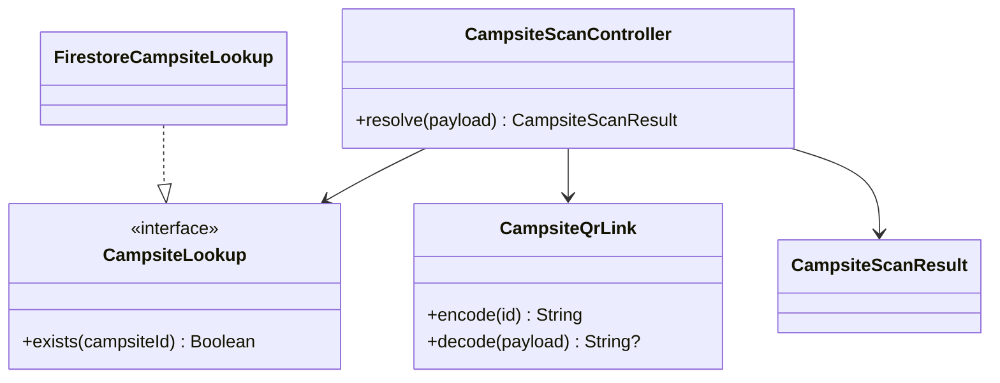

# US 01.12.01 — Scan a promotional QR code

Refs #25 and library dependency #95. Independent branch from main `ae688834`; leave unmerged until Dean authorizes it.

The entrant Scan tab launches a QR-only camera scanner using the Android activity-result contract. Permission is requested only after the user taps Scan. Denial, cancellation and unavailable hardware leave the user in the scan screen with a message and a paste-link alternative. Repeated taps are disabled while resolving a target.

The decoder accepts only canonical `symbol://campsite/v1/{encoded-id}` links shared with US 02.02.01. A server read verifies the exact campsite document before navigation. Invalid, removed, unknown and unreadable targets do not open details. A successful result enters the existing details destination, preserving live record updates and Noor/Abhishek's lottery card. No Campsite/Lottery/User schema or draw behavior is changed.

Uses ZXing core 3.5.4 and [ZXing Android Embedded 4.3.0](https://github.com/journeyapps/zxing-android-embedded), by the ZXing authors and Journey Mobile, Apache License 2.0. Attribution/license text is packaged in `assets/qr-scanner-third-party-notices.txt`. The embedded scanner supports the project's minimum API 24; camera hardware is optional for the rest of the app. No separate scanner app is required.

**Approval is not assumed:** #95 requires the TA's library approval to be recorded before production adoption. These unmerged commits are reviewable implementation and test evidence. Camera permission is still controlled by the device user. No shared Firebase documents are created or deleted by scanning.



Validation: controller tests cover the exact ID, invalid inputs without backend reads, missing records, read errors and cancellation. Screen tests cover cancellation/retry, successful decoded results, pasted invalid/missing/unavailable links, and the actual native result contract. These use a fake lookup, not live Firebase. A physical camera/poster and real server read smoke check remains required before calling the full camera path verified.

The independent QR generation branch includes an identical `CampsiteQrLink.kt`; preserve one copy when these are eventually integrated. Coordinate any future schema changes with Noor at the lookup/navigation boundary rather than rewriting the lottery model.

AI assistance: OpenAI Codex assisted implementation, tests and this note; Dean reviews the work.

## AI prompt citation

```kotlin
/** AI USAGE
 * Model: GPT-6.1 Sol
 * Prompt: "Implement scanning of the application's promotional campsite QR
 * links. Request camera permission when scanning is selected and provide
 * a paste-link alternative. Validate the supported link format and verify
 * the saved campsite exists before opening its existing details and lottery
 * flow. Handle cancellation, denied permission, malformed links, removed
 * campsites, and network failures. Add controller tests and Compose tests
 * using a fake lookup and injected scan results."
 * Date: November 6, 2026
 */
```
