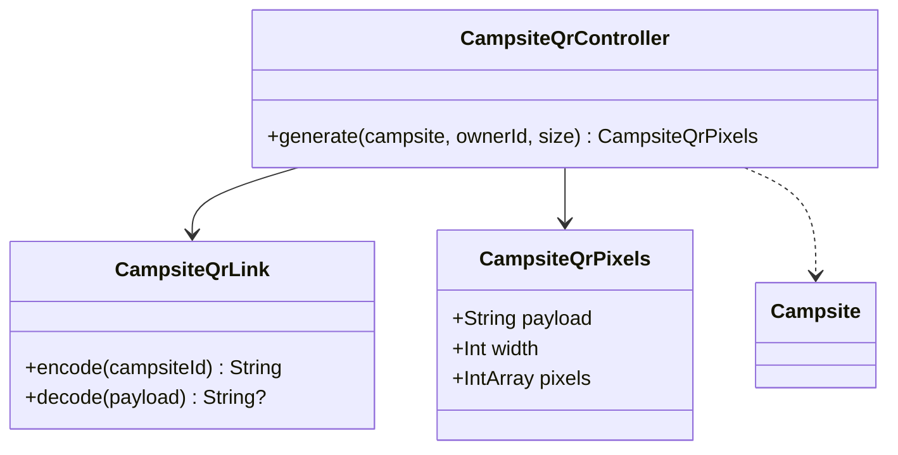

# US 02.02.01 — Generate a campsite promotional QR code

Refs #61 and dependency #95. Branch `US-02.02.01` starts from main `ae688834` and remains unmerged until Dean authorizes it.

Owners open an owned campsite, then **Show promotional QR code**. The code encodes only the saved document ID in a canonical `symbol://campsite/v1/{encoded-id}` link. It is deterministic across campsite name/detail edits and different for different campsite IDs. The owner can copy the same link for a poster. An unsaved campsite or a mismatched owner cannot generate a code. The owner route rechecks ownership on every snapshot; removal or changed ownership removes access to the code view.

The existing Create lottery flow from Noor remains present. No Campsite fields or lottery/reservation schemas are changed. A future Noor refactor should retain the saved-ID/owner boundary and the QR action alongside the lottery slot.

## Shared scanning contract

`CampsiteQrLink.kt` is shared by generation and scanning. Only canonical v1 links are accepted. Foreign hosts/schemes, unsupported versions, empty IDs, query/fragment redirects and malformed encodings are rejected. Existing QR links continue to identify the original document after display details change. The scanner validates that the document exists before navigation; a removed site does not silently open another record.

## November 6 conflict resolution

Main `89ac6bc` was incorporated into this feature branch after the scanner and other team changes landed. Both features use the existing ZXing core 3.5.4 declaration; the scanner's embedded 4.3.0 dependency and the lottery UI tests' Espresso dependency are retained. The dependency files match that main revision, with no duplicate aliases or implementations. The QR owner action remains alongside the existing lottery controls. This updates PR #120 for review; it does not merge the feature into main.

## Dependency, attribution and approval

Uses [ZXing core 3.5.4](https://github.com/zxing/zxing/releases/tag/zxing-3.5.4), by the ZXing authors, under Apache License 2.0. The APK includes attribution and license text in `assets/qr-third-party-notices.txt`.

**TA approval is not assumed.** Issue #95 requires the team to record Hanzheng Dai's approval before production adoption. This branch supplies implementation and verification for review; keep it unmerged until Dean authorizes merging and the required library approval is recorded. No live Firebase records are changed to generate a code.



Verification: JVM tests decode generated QR pixels using the actual ZXing reader, verify stable/distinct IDs and encoded characters, reject invalid payloads, and prevent unsaved/non-owner generation. A regression covers long IDs on a small requested canvas. Screen tests cover QR navigation, returning to existing lottery controls, rendering, and copying the matching link without modifying the test runner's real clipboard. Camera decoding is exercised separately in US 01.12.01; a physical-device camera/poster smoke check remains part of the demo.

AI assistance: OpenAI Codex assisted implementation, tests and documentation. Dean reviews the work.

## AI prompt citation

Suggested replication prompt with the model and date requested by Dean; this is not a verbatim record of the original session.

```kotlin
/** AI USAGE
 * Model: GPT-6.1 Sol
 * Prompt: "Implement promotional QR generation for a saved campsite owned
 * by the current user. Encode a stable, versioned link containing the saved
 * campsite ID, compatible with the existing scanner. Display the QR code
 * and provide a copy-link action while preserving lottery controls.
 * Reject unsaved records and ownership mismatches. Include attribution
 * for the QR library. Test actual QR encoding and decoding, distinct IDs,
 * stability after edits, long IDs, and owner-screen navigation."
 * Date: November 6, 2026
 */
```
