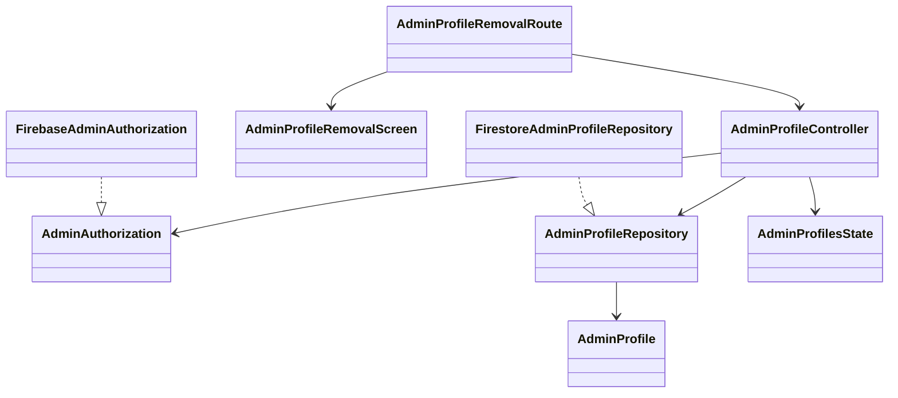

# US 03.02.01 — remove a profile

Refs [#82](https://github.com/CMPUT301F26-symbol/symbol-cyber/issues/82). Independent branch `US-03.02.01`, based on main `ae68883`; do not merge until Dean authorizes it.

## Behavior

Admin → Profiles displays active profiles after verifying the signed-in Firebase session's refreshed `admin: true` custom claim. Select Remove, check the named profile, then confirm. A successful transaction replaces the profile with a non-personal inactive marker and removes its row. Normal profile startup will refuse to recreate that record. The admin cannot remove their own profile.

Campsites, reservations, waitlists and the Firebase Auth account are retained. The inactive record contains only the profile ID, inactive flag and removal timestamp.

## Server authorization

See the [November 24 backend integration notes](dean-open-stories.md#backend-integration) for the current authorization conditions and the Firebase test matrix.

## Design



## Validation

Five controller tests cover authorization, revoked access, invalid/self IDs, successful/repeated removal, persistence failure, and failed-list retry. Three Compose tests cover confirmation/cancellation, failure/retry, and denied access using a fake repository. All pass on the API 36 emulator. Debug application and test APK builds, the full JVM suite, and Android lint pass. No live administrator identity is provisioned by these tests.

Run `./gradlew :app:testDebugUnitTest :app:assembleDebug :app:assembleDebugAndroidTest :app:lintDebug` from `code`, then the `com.example.code.ui.AdminProfileRemovalTest` instrumented test class on an emulator.

AI assistance: Codex (OpenAI) assisted with implementation, tests, and this documentation. Dean remains responsible for reviewing the result and the live acceptance checks.

## AI prompt citation

```kotlin
/** AI USAGE
 * Model: GPT-6.1 Sol
 * Prompt: "Implement administrator profile removal using the existing
 * users collection without replacing the shared User model or identity
 * repository. Require a refreshed Firebase admin custom claim before listing
 * profiles and before deletion. Require confirmation, prevent self-removal,
 * remove successful deletions from the list, and retain failed deletions
 * for retry. Delete only the selected profile document. Document the required
 * server authorization rules without deploying them. Add controller and
 * Compose tests using fake data, including denied access and cancellation."
 * Date: November 6, 2026
 */
```

```kotlin
/** AI USAGE
 * Model: GPT 6.2 Sol
 * Prompt: "Update the Admin Profiles screen so a verified administrator can
 * confirm removal of a selected user profile. Prevent self-removal. Use a
 * Firestore transaction to replace personal fields with an inactive marker,
 * preserve reservation history, and prevent the removed profile from returning
 * through sign-in. Keep failed removals available for retry and test
 * cancellation, denial, and successful removal."
 * Date: November 24, 2026
 */
```
