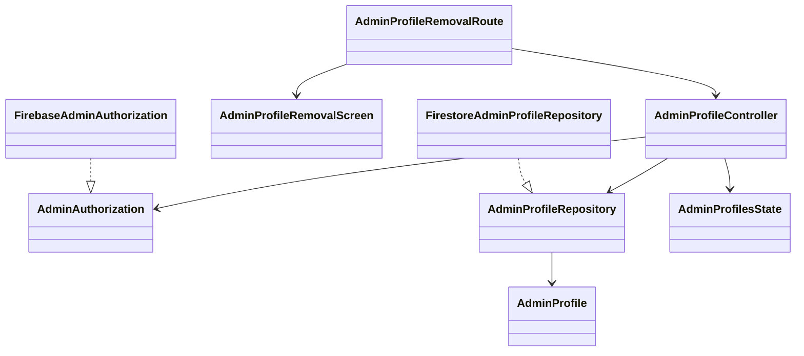

# US 03.02.01 — remove a profile

Refs [#82](https://github.com/CMPUT301F26-symbol/symbol-cyber/issues/82). Independent branch `US-03.02.01`, based on main `ae68883`; do not merge until Dean authorizes it.

## Behavior

Admin → Profiles displays existing active profiles after verifying the signed-in Firebase session's refreshed `admin: true` custom claim. Select Remove, review the named profile, then confirm. Cancellation does not write anything. A successful transaction deletes the selected `users/{deviceId}` profile document and removes its row. Missing records are handled without reporting a new deletion; failed writes retain the row and allow retry. The current profile cannot be removed through this administrative flow.

Only the profile document is deleted. Firebase Auth accounts, campsite documents, waitlists, and reservation records are retained. This does not ban a device. Coordinate with Amr's profile creation work if a removed device must be prevented from creating a new profile.

The removal view has a minimal profile selector; Fahad's separate browsing story can reuse this action. `AdminProfileRemovalRoute` and its lightweight repository avoid replacing Fahad's browsing screen or Amr's `UserRepository`/`User` schema. Existing inactive/deleted markers are excluded when present; existing documents need no migration. Noor's campsite and lottery models are unchanged.

## Server authorization required before live use

No claims or security rules are deployed by this branch. The mode switch is not authorization. A Firebase administrator must provision the `admin: true` custom claim through a trusted Admin SDK and integrate reviewed Firestore rules. See [custom claims](https://firebase.google.com/docs/auth/admin/custom-claims) and [security rules](https://firebase.google.com/docs/rules/basics).

The following is a scoped integration fragment, **not a replacement for the project's production rules**:

```text
function isProfileAdmin() {
  return request.auth != null && request.auth.token.admin == true;
}
match /users/{profileId} {
  allow get, list, delete: if isProfileAdmin();
}
```

Preserve reviewed self-profile create/update permissions separately. Audit overlapping rules: any broad permissive rule can also grant access. Ordinary profile fields or client-selected roles must never grant administrative authority. The profile transaction reads before deleting, so administrators need both get and delete permissions.

Before deployment, verify server rules with authenticated nonadmin and admin identities: nonadmins cannot list/read/delete other profiles; admins can remove a selected record; changing a profile's role field cannot grant a signed custom claim; denied writes retain the profile. These server-rule tests and live backend deletion remain pending. No shared Firebase data was deleted during development.

## Design



## Validation

Five controller tests cover authorization, revoked access, invalid/self IDs, successful/repeated removal, persistence failure, and failed-list retry. Three Compose tests cover confirmation/cancellation, failure/retry, and denied access using a fake repository. All pass on the API 36 emulator. Debug application and test APK builds, the full JVM suite, and Android lint pass. No live administrator identity is provisioned by these tests.

Run `./gradlew :app:testDebugUnitTest :app:assembleDebug :app:assembleDebugAndroidTest :app:lintDebug` from `code`, then the `com.example.code.ui.AdminProfileRemovalTest` instrumented test class on an emulator.

AI assistance: Codex (OpenAI) assisted with implementation, tests, and this documentation. Dean remains responsible for reviewing the result and the live acceptance checks.

## AI prompt citation

```kotlin
/** AI USAGE
 * Model: GPT-6.1 Sol
 * Prompt: "Implement administrator profile removal using the existing
 * users collection without replacing the shared User model or identity
 * repository. Require a refreshed Firebase admin custom claim before listing
 * profiles and before deletion. Require confirmation, prevent self-removal,
 * remove successful deletions from the list, and retain failed deletions
 * for retry. Delete only the selected profile document. Document the required
 * server authorization rules without deploying them. Add controller and
 * Compose tests using fake data, including denied access and cancellation."
 * Date: November 6, 2026
 */
```
